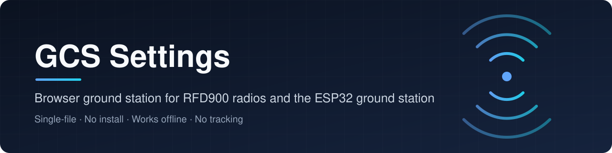
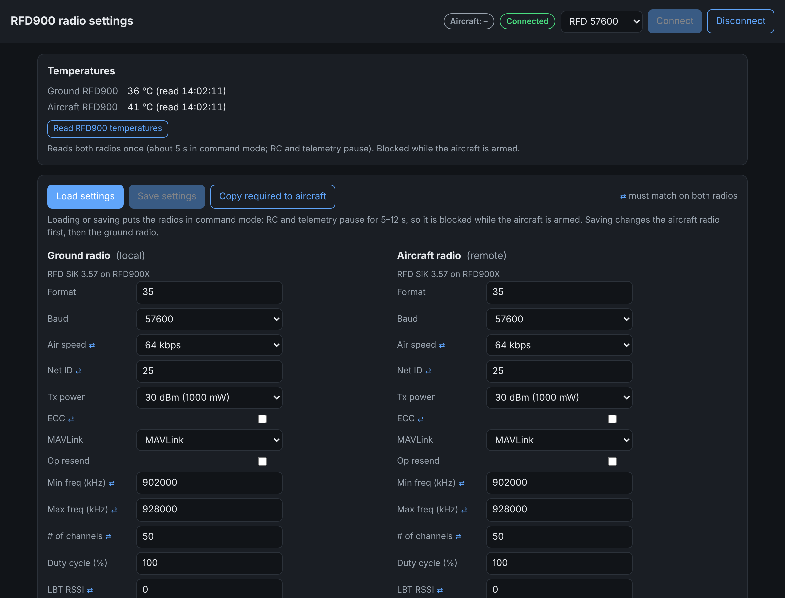

  

  <a href="https://narl3yyy-svg.github.io/gcs-settings/indexRFD.html"><b>RFD900 Tool</b></a>
  &nbsp;·&nbsp;
  <a href="https://narl3yyy-svg.github.io/gcs-settings/"><b>Full Ground Station</b></a>
  &nbsp;·&nbsp;
  <a href="#quick-start">Quick start</a>
  &nbsp;·&nbsp;
  <a href="#licensing">Licensing</a>
  &nbsp;·&nbsp;
  <a href="#changelog">Changelog</a>

---

## Overview

**GCS Settings** configures and monitors long-range telemetry links built on **RFD900** radios,
directly from the browser. Connect over USB, read and compare both radios side by side, change
settings safely and watch the link, without installing anything.

Each page is a **single self-contained HTML file**: no installer, no server, no account and no
tracking. Saved locally, it runs entirely offline.

  
   
  RFD900 tool, dark theme (sample values from a simulated radio)

## Editions

| | **RFD900 Tool** | **Full Ground Station** |
|---|---|---|
| File | [`indexRFD.html`](https://narl3yyy-svg.github.io/gcs-settings/indexRFD.html) | [`index.html`](https://narl3yyy-svg.github.io/gcs-settings/) |
| Radio settings, temperatures, AT console | ✓ | ✓ |
| ELRS, GPS, ArduPilot telemetry and missions | | ✓ |
| Map with offline areas | | ✓ |
| Internet access | Never | Optional (online maps) |
| Third-party code | None | MapLibre GL JS (map) |
| Licensing | **Commercial product** | Personal / non-commercial (Esri map content) |

## Features

**Radio configuration**
- Load, compare and save settings on the ground and aircraft radios, with fields that must match
  highlighted
- Copy the required settings to the aircraft radio, or reset either radio to factory defaults
- Read both radios' temperatures
- AT console with the complete SiK command reference

**Connectivity**
- ESP32 ground station, or a plain RFD900 on a USB-serial cable (direct mode at the chosen baud)
- Automatic recovery from serial errors; unplugging is detected and stale readings are cleared

**Flight operations** *(Full Ground Station)*
- ArduPilot telemetry, flight modes, commands, parameters and flight logs over MAVLink
- Mission planning on the map: click to add waypoints, drag to move, Mission Planner `.waypoints`
- ELRS link status, output power, binding phrase and bind; RC rate and Follow-mode ground position

**Maps** *(Full Ground Station)*
- Smooth zoom, rotation and tilt (MapLibre GL JS); Esri Satellite, Streets and Topographic
- Offline areas up to 200 sq mi saved to a folder of your choice, with stop and resume
- **Private (offline only)** mode, on by default: no map requests leave the computer

**Safety**
- Actions that interrupt RC (radio command mode, power changes, reboots) are blocked while the
  aircraft is armed and confirmed otherwise

## Quick start

1. Open a page in **Chrome** or **Edge** on a PC (or Chrome on Android for the ESP32 over USB).
2. Connect the ESP32 ground station or the RFD900's USB cable.
3. For a plain RFD900, choose its baud rate next to **Connect** (usually 57600).
4. Select **Connect** and pick the COM port.

> [!TIP]
> To use the tool without internet, open it once and choose **Save this page to the PC** (Full
> Ground Station) or save the page with <kbd>Ctrl</kbd>+<kbd>S</kbd>, then open the saved file.

> [!NOTE]
> No COM port listed? Install the cable's USB driver (FTDI or CP210x) and close other programs
> using the port, such as Mission Planner.

## Requirements

| Component | Requirement |
|---|---|
| Browser | Chrome or Edge (Web Serial). Chrome on Android uses WebUSB for the ESP32. |
| Radios | RFD900 family with SiK firmware |
| Ground station | ESP32 ground station firmware, or a plain RFD900 with an FTDI / CP210x cable |
| Autopilot | ArduPilot, for telemetry, missions, parameters and the armed check |
| Graphics | WebGL, for the map (Full Ground Station only) |

## Privacy

- No accounts, analytics, tracking or advertising. No data about you, your aircraft or your radios
  is sent anywhere.
- The RFD900 Tool makes **no internet requests**.
- In the Full Ground Station, **Private (offline only)** is on by default, so the map shows only
  areas saved on your computer. With it off, map squares are fetched from Esri, which then sees
  your IP address and the area requested; no cookies or page address are sent.
- Settings, saved areas and missions stay on your computer.

## Dependencies

<b>Embedded libraries</b> (Full Ground Station map only)

 

All radio, MAVLink, ELRS and mission code is written directly in the page. The map uses
[MapLibre GL JS](https://maplibre.org) 5.24.0 (BSD-3-Clause), embedded in the file together with
the libraries it includes:

| Library | Version | License |
|---|---|---|
| @mapbox/jsonlint-lines-primitives | 2.0.3 | MIT |
| @mapbox/point-geometry | 1.1.0 | ISC |
| @mapbox/tiny-sdf | 2.3.0 | BSD-2-Clause |
| @mapbox/unitbezier | 0.0.1 | BSD-2-Clause |
| @mapbox/vector-tile | 2.0.5 | BSD-3-Clause |
| @mapbox/whoots-js | 3.1.0 | ISC |
| @maplibre/geojson-vt | 6.3.3 | ISC |
| @maplibre/maplibre-gl-style-spec | 24.10.0 | ISC |
| @maplibre/mlt | 1.3.0 | MIT (dual MIT / Apache-2.0) |
| @maplibre/vt-pbf | 4.3.3 | MIT |
| earcut | 3.2.4 | ISC |
| gl-matrix | 3.4.4 | MIT |
| json-stringify-pretty-compact | 4.0.0 | MIT |
| kdbush | 4.1.0 | ISC |
| murmurhash-js | 1.0.0 | MIT |
| pbf | 4.0.2 | BSD-3-Clause |
| potpack | 2.1.0 | ISC |
| quickselect | 3.0.0 | ISC |
| tinyqueue | 3.0.0 | ISC |

MapLibre GL JS also contains code from mapbox-gl-js v1.13 (BSD-3-Clause), glfx.js (MIT) and
d3-color (BSD-3-Clause).

<b>Browser features</b>

 

| Feature | Purpose | RFD900 Tool | Full Ground Station |
|---|---|:---:|:---:|
| Web Serial | USB connection on a PC | ✓ | ✓ |
| WebUSB | USB connection to the ESP32 on Android | ✓ | ✓ |
| File System Access | Offline maps folder, saving the page | | ✓ |
| IndexedDB | Remembering the maps folder | | ✓ |
| localStorage | Map choice, map view, Private mode | | ✓ |
| WebGL | Drawing the map | | ✓ |

<b>Online services</b> (optional)

 

| Service | When it is contacted |
|---|---|
| Esri ArcGIS Online (`server.arcgisonline.com`) | Online maps with Private off, and "Download area" |
| GitHub Pages | Opening the live site (not a saved copy) |
| ardupilot.org | Only when a parameter name is clicked, to open its documentation |

## Licensing

| Part | License | Terms |
|---|---|---|
| Project code (`indexRFD.html`, `index.html`) | **MIT** © 2026 narl3yyy-svg | Free to use, modify, distribute and sell with the copyright notice and license text. Provided without warranty. See [`LICENSE`](LICENSE). |
| Embedded libraries (MapLibre GL JS and its parts) | BSD-2-Clause, BSD-3-Clause, MIT, ISC | Permissive; notices and full license texts are in the **About** tab and must remain with any copy. |
| Map content (Esri) | Esri terms of use | Personal / non-commercial use only. Users are responsible for complying with Esri's terms, including for saved areas. |

> [!IMPORTANT]
> The commercial product is the **RFD900 Tool** (`indexRFD.html`). It contains no map content and
> no third-party code, so third-party and map terms do not apply to it.

<b>Map credits</b>

 

- **Esri World Imagery:** Imagery © Esri, Maxar, Earthstar Geographics, and the GIS User Community.
- **Esri World Street Map, World Topographic Map:** © Esri, HERE, Garmin, © OpenStreetMap
  contributors, and the GIS User Community.
- **Earlier sources** (USGS, NAIP, OpenAerialMap, `.pmtiles` street maps) are no longer used. Areas
  saved from them are public domain or CC BY 4.0 and may be kept.

<b>Trademarks</b>

 

RFD900 is a trademark of RFDesign; ESP32 is a trademark of Espressif Systems. ExpressLRS, ArduPilot
and MAVLink are names of their respective projects. They are used only to describe compatibility;
this product is not affiliated with or endorsed by them.

## Changelog

<b>November 24, 2026</b>: Privacy, offline maps and Esri imagery

 

- **Private (offline only)** mode, on by default; map requests send no cookies or page address
- **Offline map** option shows a saved area from disk and is selected automatically by *Show on map*
- Esri Satellite (to zoom 19), Streets and Topographic restored; downloads to zoom 15–19, 8 tiles at a time
- **Stop** in *Download area* takes effect immediately; requests time out after 20 seconds
- ELRS output power lists the levels the board reports; *Match handset power* removed
- Ground Station tab: RC rate, ground position and board tiles moved below Mission
- Map viewer moved from Leaflet to MapLibre GL JS
- Removed: `.pmtiles` street maps, USGS, NAIP and OpenAerialMap imagery

<b>November 23, 2026</b>: Licensing and the RFD900 Tool

 

- **About** tab with every embedded component's copyright and license text, map credits and trademarks
- New **RFD900 Tool** (`indexRFD.html`) with a Temperatures card and armed-state protection
- Temperature readings clear when the device disconnects

<b>November 20, 2026</b>: Disconnect handling

 

- Unplugging switches to *Not connected* within seconds and clears both radio columns
- A running radio command ends immediately when the device is removed

<b>November 7, 2026</b>: Offline maps

 

- Save map areas to a chosen folder with size estimates, progress and resume
- Map library embedded; *Save this page to the PC* creates a fully offline copy

<b>November 6, 2026</b>: Direct RFD900 mode

 

- All COM ports listed; a plain RFD900 is detected and driven directly at the chosen baud rate

<b>October 19, 2026</b>: Reliable radio reads

 

- Reading continues after serial errors instead of stopping until the board is replugged
- Larger receive buffer, long replies kept, and stray bytes no longer corrupt the next reply
- Read-only commands retry once; board errors are reported immediately; Disconnect no longer hangs

---

  © 2026 narl3yyy-svg · Released under the <a href="LICENSE">MIT License</a> · Not affiliated with RFDesign, Espressif, ExpressLRS or ArduPilot

